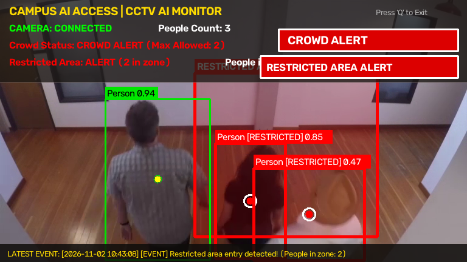

# Campus AI Access

## Overview

**Campus AI Access** is a prototype AI + CCTV monitoring module developed for a Smart Campus Management System hackathon project. 

This module serves as the automated computer vision backbone of the system. It processes live camera footage or local video streams using a lightweight pretrained YOLO object detection model to detect pedestrians, count real-time occupancy, trigger crowd alerts when safety thresholds are breached, and enforce perimeter security through rectangular restricted-zone monitoring.

---

## Problem

Educational institutions and modern campuses often struggle to monitor large physical areas effectively:
- Manual CCTV monitoring is labour-intensive and prone to human fatigue.
- Overcrowding at campus bottlenecks (such as cafeteria entrances, auditorium lobbies, or exam hall passages) poses safety and emergency evacuation risks.
- Unauthorized entry into restricted security zones (such as server rooms, maintenance sub-stations, lab storerooms, or faculty-only corridors) often goes unnoticed until after an incident occurs.

---

## Solution

The **AI + CCTV Monitoring Module** provides an automated, real-time safety layer using computer vision:
1. **Automated Person Detection:** Continuously detects individuals entering the camera's field of view without human intervention.
2. **Real-time Occupancy & People Counting:** Calculates the exact number of people present in the frame.
3. **Crowd Alerts:** Automatically raises an alert banner when the number of people exceeds a configurable limit (`MAX_PEOPLE`).
4. **Restricted Zone Protection:** Monitors a predefined bounding region and raises an intrusion alert with a timestamped security event whenever someone enters the restricted zone.

---

## Features

- **Real-time Person Detection:** Identifies people in each frame using a pretrained lightweight YOLO model.
- **Visual Bounding Boxes:** Draws clean bounding boxes around every detected person with confidence scores and center-point indicators.
- **Live People Counting:** Continuously counts and updates the total number of people on screen.
- **Crowd Threshold Alert:** Generates a prominent `CROWD ALERT` whenever occupancy exceeds the configured limit.
- **Restricted Area Detection:** Monitors a user-defined rectangular zone and verifies whether a person's center coordinates fall inside.
- **Security Event Generation:** Logs timestamped `[EVENT]` entries to the terminal and displays alerts on screen when restricted zones are entered.
- **Camera Connection Status:** Displays `CAMERA: CONNECTED` or graceful `CAMERA: DISCONNECTED` status.
- **Laptop Webcam Support:** Default plug-and-play support for built-in or USB laptop webcams (`SOURCE = 0`).
- **Local Sample-Video Support:** Easily switch to local video files (e.g., `sample_video.mp4`) for testing or demonstrations.
- **Zero Heavy Infrastructure:** Runs on standard Windows laptops with ~8 GB RAM without requiring a dedicated GPU or external servers.

---

## Technology

- **Python 3:** Core programming language.
- **OpenCV (`opencv-python`):** Video frame acquisition, geometric calculations, bounding box rendering, HUD display, and window management.
- **Ultralytics YOLO:** State-of-the-art, lightweight object detection framework.
- **Pretrained `yolov8n.pt` Model:** YOLOv8 Nano model pretrained on the COCO dataset (~6 MB), optimized for high-speed CPU inference on everyday laptops.

---

## Project Structure

```text
campus-ai-access/
│
├── detection.py        # Main CCTV monitoring application
├── requirements.txt    # Project dependencies (OpenCV & Ultralytics YOLO)
├── README.md           # Documentation and setup instructions
├── sample_output.png   # Verification screenshot of the running CCTV monitor
├── sample_video.mp4    # (Optional) Sample CCTV footage for testing
└── yolov8n.pt          # Pretrained lightweight YOLO model weights
```

---

## Installation

Follow these steps to set up the project on Windows:

### 1. Open Terminal / PowerShell
Navigate to the project directory:
```powershell
cd campus-ai-access
```

### 2. Create a Virtual Environment
```powershell
python -m venv .venv
```

### 3. Activate the Virtual Environment
```powershell
.venv\Scripts\activate
```

### 4. Install Dependencies
```powershell
pip install -r requirements.txt
```

---

## Running

Run the main application using Python:

```powershell
python detection.py
```

### Webcam
By default, `SOURCE = 0` is configured in `detection.py`, which opens your primary laptop webcam.

### Sample Video
To test with a local sample video, you can either:
1. Pass the video path as a command-line argument:
   ```powershell
   python detection.py sample_video.mp4
   ```
2. Or open `detection.py` and modify the configuration at the top:
   ```python
   SOURCE = "sample_video.mp4"
   ```

---

## Configuration

All primary settings are located at the top of [`detection.py`](file:///C:/Users/Pooja/.gemini/antigravity/scratch/campus-ai-access/detection.py) for easy customization without touching detection logic:

| Setting | Default Value | Description |
| :--- | :--- | :--- |
| `MODEL_PATH` | `"yolov8n.pt"` | Pretrained YOLO model file (lightweight Nano version). |
| `SOURCE` | `0` | Video input: `0` for laptop webcam or `"sample_video.mp4"` for local file. |
| `MAX_PEOPLE` | `5` | Maximum number of people allowed before `CROWD ALERT` triggers. |
| `CONFIDENCE_THRESHOLD` | `0.50` | Minimum confidence score (0.0 to 1.0) required to register a person. |
| `RESTRICTED_AREA` | `(320, 120, 620, 390)` | Rectangular coordinates `(x1, y1, x2, y2)` defining the restricted zone. |

---

## Controls

- **`Q` or `q`:** Safely quit the application, release the camera/video stream, and close all OpenCV windows.
- **Window Close (`X`):** Cleanly terminates the program.

---

## Expected Output

When running, the OpenCV monitoring window displays:
1. **Live Video Feed:** Smooth stream from your webcam or sample video.
2. **Camera Connection Status:**
   - `CAMERA: CONNECTED` (Green text) when the source is active.
   - `CAMERA: DISCONNECTED` (Red error screen) if the camera cannot be opened.
3. **Person Bounding Boxes:**
   - **Bright Green Box:** Person outside the restricted area with label `Person <confidence>` and center point.
   - **Bold Red Box:** Person inside the restricted area with label `Person [RESTRICTED] <confidence>` and highlighted center target.
4. **People Count:** Live display of current occupancy (`People Count: X`).
5. **Crowd Status:**
   - `Crowd Status: NORMAL (Max: 5)` when occupancy is within threshold.
   - `Crowd Status: CROWD ALERT (Max Allowed: 5)` and a red `CROWD ALERT` badge when exceeded.
6. **Restricted Area Zone:**
   - Prominently labeled rectangle (`RESTRICTED AREA`) with a semi-transparent tinted overlay.
   - `Restricted Area: CLEAR` when no one is inside.
   - `Restricted Area: ALERT (X in zone)` with a red badge and terminal event log when breached.
7. **Security Event Banner:** Bottom ticker showing the latest timestamped security intrusion event.

---

## Verification Screenshot

Below is a verified output screenshot captured from the application running on sample CCTV footage:



*The screenshot demonstrates simultaneously active camera connection status, person detection boxes, people counting, crowd alert threshold triggering, restricted area breach visualization, and timestamped event logging.*

---

## Limitations

- **Prototype Scope:** This application is a hackathon proof-of-concept designed to run locally.
- **Local Input:** It operates via a local laptop webcam or sample video file; it does not connect to live institutional CCTV/RTSP camera grids.
- **No Facial Recognition:** The application detects the presence and location of the `person` class. It does not perform facial recognition or identify specific students or staff.
- **No Database or API:** Events are logged to the terminal and rendered on the video window. No external database or REST API server is included in this standalone module.
- **Detection Variance:** Detection accuracy and framerate depend on ambient lighting, camera resolution, viewing angle, and CPU capacity.

---

## Future Scope

In a production campus deployment, this AI + CCTV module can be extended to integrate with:
- Authorized campus IP/RTSP camera network streams.
- Central backend management API (e.g. FastAPI / Node.js) for persistent event logging.
- SQL or time-series databases for historical occupancy trends and incident auditing.
- Automated instant notifications (SMS/Email/Push alerts) to campus security dispatchers.
- Integration with smart campus turnstiles and access control checkpoints.
